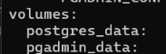
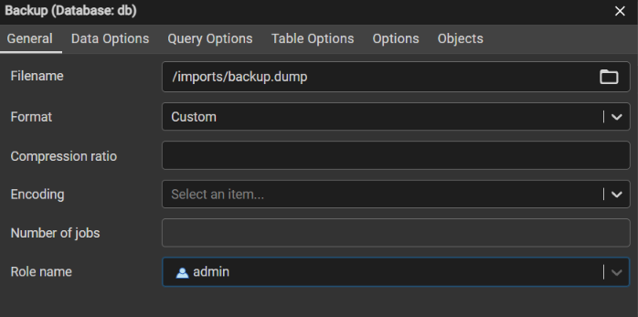
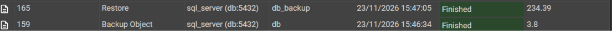
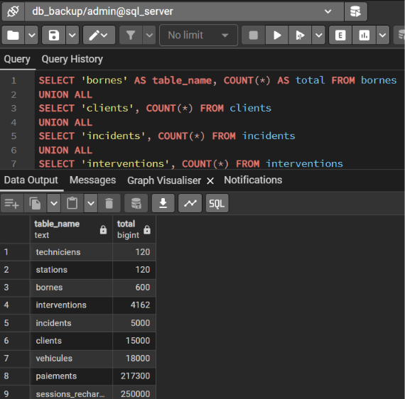

# Sauvegardes

## Persistance de la base

Dans le fichier compose.yaml pour mettre docker,on permet de mettre des volumes pour le serveur de base de données et pgadmin qui seront gérer par docker.



## Procédure de sauvergardes et restauration

La sauvegarde des bases de données permet de protéger les informations contre les pertes de données, les erreurs humaines ou les incidents techniques.

L'objectif est de mettre en place une procédure permettant de sauvegarder régulièrement la base de données et de pouvoir la restaurer en cas de problème.

Une sauvegarde de la base de données `db` est réalisée à l'aide de pgAdmin.

Cette opération permet de générer un fichier contenant les données de la base ainsi que les éléments nécessaires à leur restauration.

Les sauvegardes doivent être conservées dans un emplacement sécurisé et accessible uniquement aux personnes autorisées.



Afin de vérifier le bon fonctionnement de notre procédure, nous avons effectué un test de restauration.

Pour cela, nous avons créé une nouvelle base de données nommée `<span>db_backup</span>`, dans laquelle nous avons restauré la sauvegarde précédemment réalisée.

Cette méthode permet de tester la restauration sans modifier la base de données originale.



## Vérifications des données

Pour vérifier les données,on fait la requête sql suivante pour chaque table sur les deux bases et on vérifie si les données sont identiques.

```SQL
SELECT COUNT(*) from <table>
```

Résultats de *db* :

| table_name        | total  |
| ----------------- | ------ |
| techniciens       | 120    |
| stations          | 120    |
| bornes            | 600    |
| interventions     | 4162   |
| incidents         | 5000   |
| clients           | 15000  |
| vehicules         | 18000  |
| paiements         | 217300 |
| sessions_recharge | 250000 |

Résulats de *db_backup* :

| table_name        | total  |
| ----------------- | ------ |
| techniciens       | 120    |
| stations          | 120    |
| bornes            | 600    |
| interventions     | 4162   |
| incidents         | 5000   |
| clients           | 15000  |
| vehicules         | 18000  |
| paiements         | 217300 |
| sessions_recharge | 250000 |



Les résulats sont identiques donc les données sont bien implémenter après réstauration.
